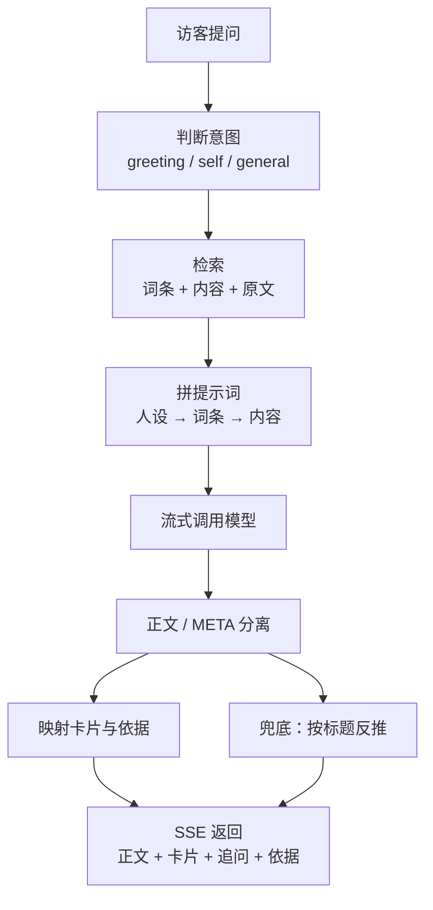
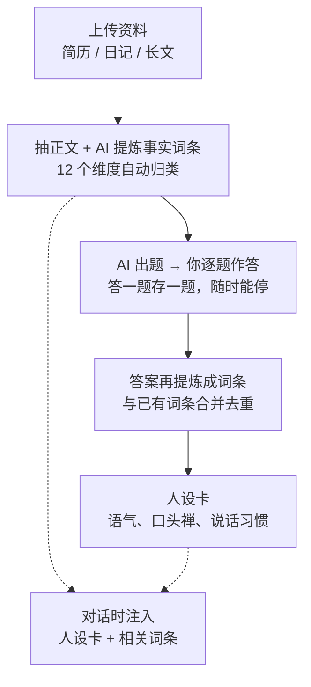

<div align="center">

# 对话式博客

**把博客做成一间可以聊天的房间。**

访客打开首页看到的不是文章列表，而是一个对话框。
AI 用作者自己的口吻回答，答到作品时把作品卡片递出来——能点开，也能直接下载。

<br>


<!-- 不想公开自己的站点就删掉下面这一行 -->
**[🌐 在线示例](https://www.pnds.asia)** · **[🚀 快速开始](#-快速开始)** · **[🧠 蒸馏是怎么做的](#-蒸馏从一堆文件到一个像你的人)**

</div>

---

## 这是什么

传统博客是**书架**：你写，别人按时间顺序读。
这个东西是**前台**：别人问，它替你答，答完顺手把相关作品摊在桌上。

差别不在 UI，在于内容组织方式。传统博客的内容以「篇」为单位等人翻阅；这里的内容先被拆成**可检索、可引用、可挂卡片**的结构，再由模型在对话中按需取用：

```
传统博客   文章 ──→ 列表页 ──→ 读者自己找
对话式博客 文章 ──→ 事实词条 + 内容块 ──→ 模型按问题取用 ──→ 回答 + 卡片
```

所以它天然适合两类人：**作品很杂、说不清自己是谁的人**，以及**不想维护一堆栏目的人**。

---

## ✨ 功能

### 访客侧

| 功能 | 说明 |
|---|---|
| 对话首页 | ChatGPT 风格，SSE 逐字流式输出，可随时停止生成 |
| 内容卡片 | 回答提到作品时，自动把封面 / 标题 / 简介 / 跳转 / 下载摊出来 |
| 反问推荐 | 每条回答附带 2 个自然的后续问题，点击即问 |
| 依据溯源 | 回答下方折叠显示"这句话是从哪条内容来的"，**只给标题，不暴露原文** |
| 常识标注 | 用到材料以外的知识时标注「本回复含 AI 常识补充，非本人经历」，不冒充本人经历 |
| 内容库 | `/contents` 独立页面，支持搜索 + 类型筛选；每项有独立详情页 `/p/:id`，给不喜欢聊天的人 |
| 分享链接 | `/?q=问题` 直接带着问题进站，适合贴到别处 |
| 主题 | 深浅色切换，跟随系统 / 手动覆盖，**首帧就对，不闪白** |

### 作者侧（后台）

| 模块 | 能力 |
|---|---|
| **蒸馏** | 上传资料 → AI 提炼事实词条 → 12 维度出题 → 逐题作答 → 生成人设卡 |
| **内容管理** | 统一上传窗口，6 种类型（程序 / 文章 / 视频 / 音乐 / 图片 / 其他），字段随类型自动变化 |
| **概览** | 内容规模、回收站、备份数量、模型状态一屏看完 |
| **设置** | 站点文案、推荐问句、模型服务、密码修改 |

蒸馏这块的几个设计取舍：

- **答一题存一题**，随时关掉浏览器，下次接着答。1000 道题不必一次做完。
- **词条是独立资产**，不是问答的副产品。可以手动改、手动删，AI 重新整理时只覆盖 AI 生成的那部分。
- **资料 → 词条 → 问答 → 人设卡**是四层，越靠前越可信，所以检索时优先用词条，原文只做兜底。

### 工程侧

- **零数据库**：`data/db.json` 一份文件装下所有业务数据，原子写入 + 自动滚动备份 20 份。扔掉服务器，拷走 `data/` 就搬家。
- **单进程**：Node 同时提供 API、静态资源和 HTTPS，不需要 nginx / pm2 / docker。
- **首屏真值直出**：站点文案由服务端序列化进 HTML，第一帧就是真数据，省掉一次 `/api/profile` 往返。
- **模块边界清晰**：`services` 管业务、`routes` 管协议、`lib` 管纯函数，改一处不牵动全身。

---

## 🚀 快速开始

### Windows（推荐，一条命令）

> 需要 **Node.js ≥ 20.19 或 ≥ 22.12**（Vite 8 的要求；开发与部署实测 Node 24）。

```bat
start.bat
```

脚本会依次完成：检查 Node → 准备 `.env`（**首次自动生成随机密码**）→ 装依赖 → 按需构建前端 → 启动服务 → 打开浏览器。

```bat
start.bat dev     :: 开发模式：后端 8787 + 前端 5173 热更新
```

### 任意平台（手动）

```bash
# 1. 依赖
npm run install:all          # = server/ 与 web/ 各自 npm install

# 2. 配置（首次启动也会自动生成，可以跳过）
cp .env.example .env

# 3. 构建前端
npm run build

# 4. 启动
npm start
```

打开：

| 地址 | 说明 |
|---|---|
| `http://localhost:8787/` | 访客首页 |
| `http://localhost:8787/contents` | 公开内容库 |
| `http://localhost:8787/admin` | 后台（密码见启动日志或 `.env`） |

> **首次启动**：没有配 `ADMIN_PASSWORD` 时会自动生成一个 24 位随机密码，打印在控制台并写回 `.env`。不会出现"装完就是一个固定默认密码"这种事。

---

## ⚙️ 配置

主要配置项都在 `.env`：

| 变量 | 默认 | 说明 |
|---|---|---|
| `ADMIN_PASSWORD` | 自动生成 | 后台密码。改完保存即生效，不用重启；改密码会让所有已登录浏览器立刻退出 |
| `MIN_ADMIN_PASSWORD_LENGTH` | `12` | 密码最短长度（下限 6）。调低等于放弃抗爆破能力 |
| `SESSION_SECRET` | 自动生成 | 会话签名密钥。**同时用于加密模型 Key**，别随便换 |
| `SESSION_DAYS` | `7` | 登录有效期 |
| `PORT` | `8787` | 监听端口 |
| `BIND_HOST` | `127.0.0.1` | 监听地址。公网部署请配 HTTPS 后按需放开 |
| `MAX_UPLOAD_MB` | `100` | 单文件上传上限 |
| `LLM_BASE_URL` | `https://api.deepseek.com` | 任意 OpenAI 兼容端点 |
| `LLM_MODEL` | `deepseek-flash` | 模型名 |
| `LLM_ALLOW_PRIVATE` | 关闭 | 允许模型地址指向内网 / 本机（自建 Ollama、vLLM 时打开） |
| `DAILY_CHAT_LIMIT` | `800` | 全站每日对话额度 |
| `DAILY_CHAT_IP_LIMIT` | `120` | 单 IP 每日额度 |
| `DAILY_ADMIN_AI_LIMIT` | `400` | 后台 AI 调用每日额度 |
| `MACHINE_SECRET` | 空 | 换机器后想复用已加密的模型 Key 时，两台机器填同一个值 |

**模型 API Key 不写在 `.env` 里**。在后台「设置 → 模型服务」填写，加密后存到 `data/secrets/llm-key.enc`（AES-256-GCM，绑定机器指纹），既不进 `.env` 也不进 `db.json`——所以备份和整包都带不走一个可用的 Key。

---

## 🏗 架构

```
┌───────────────────────────────────────────────────────────────────┐
│  浏览器                                                           │
│  对话页 · 内容库 · 后台（React 19 + Vite 8 + Tailwind v4）        │
└─────────────────────────────────┬─────────────────────────────────┘
                                  │  HTTP / SSE
┌─────────────────────────────────▼─────────────────────────────────┐
│  Node（Express 4，单进程，自带 HTTPS）                            │
│                                                                   │
│   routes/         协议层   auth · chat · public · admin-*         │
│   services/       业务层   chat · retrieval · distill · persona   │
│   lib/            纯函数   password · secret-box · url-guard      │
│   repositories/   仓储     db（读缓存 + 原子写 + 备份）           │
└─────────────────────────────────┬─────────────────────────────────┘
                                  │
                        ┌─────────▼─────────┐
                        │  data/db.json     │
                        │  data/uploads/    │
                        │  data/secrets/    │
                        └───────────────────┘
```

### 目录

```
.
├── server/                 后端
│   ├── index.js            入口：安全头 → 路由 → 静态资源 → SPA 回落
│   ├── config.js           所有路径与配置的唯一来源
│   ├── routes/             auth · chat · public · admin-*
│   ├── services/           chat、retrieval、distill、persona
│   ├── lib/                tls、secret-box、password-policy、url-guard、security-log…
│   ├── parsers/            material-parser：pdf / docx / txt / md
│   ├── middleware/         错误处理、限流、安全头、上传
│   └── repositories/       db（原子 JSON）、contents
├── web/                    前端
│   └── src/
│       ├── pages/          PublicChat / PublicContents / PublicContent / admin/*
│       ├── components/     chat · cards · layout · admin/distill · ui
│       └── lib/            api、ProfileProvider、content-kinds
├── data/                   运行时数据（不进 git）
├── scripts/snapshot.ps1    打版本包
├── start.bat               Windows 一键启动
├── TECHNICAL.md            技术文档：架构、数据模型、接口、变更记录、ADR
└── HANDOFF.md              交接文档：需求真相、代码地图、部署、改代码硬规则
```

### 一次对话的完整链路



---

## 🧠 蒸馏：从一堆文件到一个像你的人

这是整个项目里最花心思的部分。目标是让 AI 不只是"知道你叫什么"，而是**在具体问题上像你**。



**12 个维度**：成长与家庭 · 教育与求学 · 工作与项目 · 技能与工具 · 兴趣与审美 · 价值观与判断 · 情绪与性格 · 健康与生活习惯 · 人际与感情 · 失败与遗憾 · 目标与计划 · 金钱与选择。

几个刻意的设计：

- **先词条，后原文**。词条是一句话一条事实，检索命中率高、注入成本低；原始段落只在词条没命中时兜底。
- **词条分 AI / 用户两种来源**。手动改过的不会被"重新整理"覆盖掉。
- **只有内容块能挂卡片**。词条和原文只是事实依据，不会凭空变出一张作品卡。
- **模型漏写引用也能兜底**。用「回答与标题的最长公共子串」判断它在说哪条内容——要求重合 ≥4 字、占标题 ≥60%、且贴在标题头或尾。宁可漏挂，也不挂错。

---

## 🔒 安全

个人站点最容易死在"能公网访问，但没有按公网威胁设计"。这个项目把这些当成默认值：

| 面 | 做法 |
|---|---|
| 后台入口 | 单密码 + HMAC 签名 Cookie；会话密钥 = `HMAC(SESSION_SECRET, 当前密码)`，**改密码即刻让所有旧会话失效** |
| 暴力破解 | 指数退避 + 失败到阈值后全站锁定；IPv6 按 `/64` 聚合，换地址没用 |
| 密码质量 | 太弱（太短 / 常见口令 / 只有一类字符）时**锁住模型服务配置**，防止有人登进来把 Key 导走 |
| API Key | AES-256-GCM 加密 + 绑机器指纹；明文不落盘、不进 `.env`、不进日志 |
| SSRF | 模型地址只接受公网 HTTPS；拒私网 / 本机地址，并做 DNS 复核防解析绕过 |
| 传输 | 非本机访问强制 HTTPS；判据用 `request.secure`（受 `trust proxy` 约束），不手读 `X-Forwarded-Proto` |
| 响应头 | CSP、HSTS、`X-Content-Type-Options`、`Referrer-Policy` |
| 额度 | 全站 / 单 IP / 后台 AI 三档每日上限，防刷爆账单 |
| 审计 | 登录成功与失败都写 `data/logs/security.log`；错误信息对外脱敏 |

> 这不是"安全产品"，是一个认真对待了安全边界的个人项目。生产部署前请自行审视 `TECHNICAL.md` §7 与实际暴露面。

---

## 🌍 部署

### HTTPS（推荐，不需要 nginx）

把证书放进 `data/certs/` 即可，Node 自己终结 TLS：

```
data/certs/fullchain.pem    ← 叶子证书 + 中间证书（顺序不能反）
data/certs/privkey.pem      ← 对应私钥
```

启动日志会打印协议、证书域名和剩余天数；证书与私钥不匹配时自动退回 HTTP 并告警。

用其他位置也行：

```bash
TLS_CERT_FILE=/etc/letsencrypt/live/example.com/fullchain.pem
TLS_KEY_FILE=/etc/letsencrypt/live/example.com/privkey.pem
```

### 常驻（systemd）

```ini
[Unit]
Description=Chat Blog
After=network.target

[Service]
Type=simple
WorkingDirectory=/srv/chat-blog
ExecStart=/usr/bin/node server/index.js
Restart=always
RestartSec=3
User=www-data

[Install]
WantedBy=multi-user.target
```

```bash
sudo systemctl daemon-reload
sudo systemctl enable --now chat-blog
```

### 搬家

拷走整个 `data/` 目录就够（`db.json`、`uploads/`、`secrets/`、`.session-secret`）。
⚠️ **`data/secrets/llm-key.enc` 绑机器指纹**，换了机器解不开——到了新机器去后台重填一次 Key 即可（30 秒）。

---

## 📚 文档

| 文件 | 内容 |
|---|---|
| [TECHNICAL.md](./TECHNICAL.md) | 技术文档：数据模型、接口协议、输出格式、变更记录、54 条 ADR、版本表 |
| [HANDOFF.md](./HANDOFF.md) | 交接文档：需求演变真相、代码地图、核心链路、部署步骤、改代码硬规则、排错速查 |

两份文档都是**给 AI 看也能看懂**的写法：每条决策都记了「改了什么 / 达到什么目的 / 为什么要改」，方便换个人或换个模型接手。

---

## ❓ FAQ

<details>
<summary><b>为什么不用数据库？</b></summary>

个人博客的数据量级是"几百条内容 + 几千条词条"，SQLite 都嫌重。JSON 文件 + 内存缓存 + 原子写 + 滚动备份，在这个量级上更简单、更透明、更好搬。
真到了多实例的规模，就该换架构了——那时 `repositories/` 是唯一需要动的层。
</details>

<details>
<summary><b>为什么不用现成的博客框架？</b></summary>

因为核心需求不是"发布文章"，是"把一个人拆成可检索的结构，再在对话里重组出来"。这一层没有现成轮子。
</details>

<details>
<summary><b>一定要用 DeepSeek 吗？</b></summary>

不用。任何 OpenAI 兼容端点都行，后台「设置 → 模型服务」改 `Base URL` + 模型名 + Key 即可。自建 Ollama / vLLM 需要显式打开 `LLM_ALLOW_PRIVATE=1`。
</details>

<details>
<summary><b>能当普通博客用吗？</b></summary>

能。`/contents` 是完整的公开内容库，带搜索和类型筛选。对话只是多出来的一层入口。
</details>

<details>
<summary><b>答错了 / 编造了怎么办？</b></summary>

三条防线：① 提示词要求"材料里没有就说记不清"；② 回答下方「依据」能点开看它引用了哪几条；③ 用到材料外的知识会明确标注「含 AI 常识补充」。**发现编造就补词条**——这是这个系统越用越准的方式。
</details>

---

## 📄 许可

个人项目，**未指定开源许可证**。代码公开供参考，转载请注明出处。

<div align="center">
<br>

**如果这个思路对你有用，点个 ⭐ 就好。**

<sub>Built with React · Vite · Tailwind · Express · 以及一个不太想写文章的人</sub>

</div>
